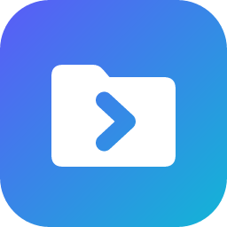
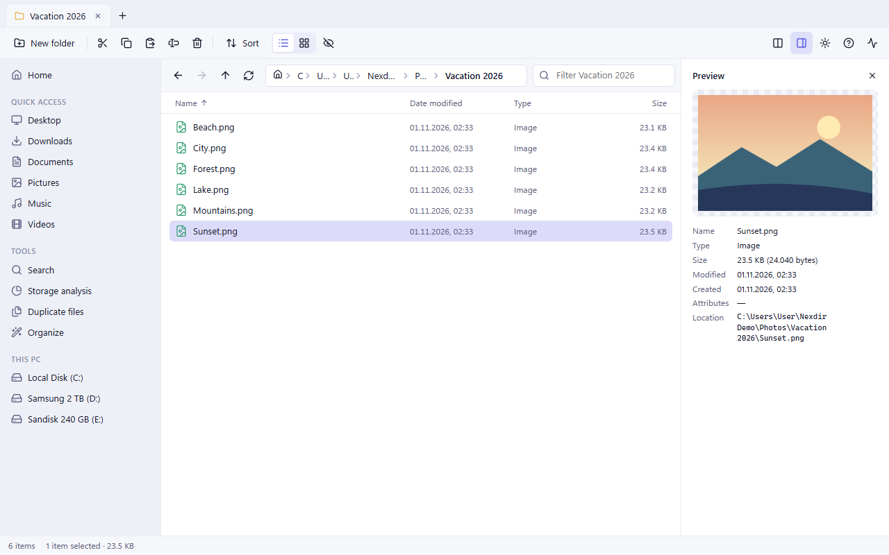
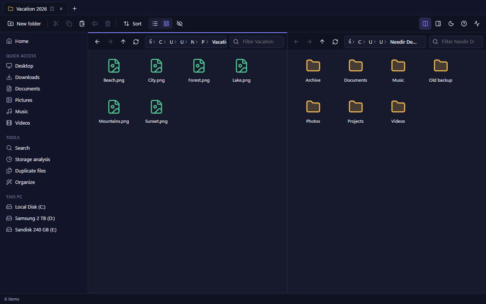
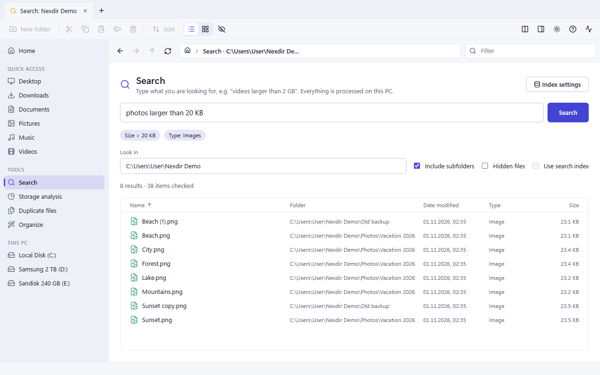
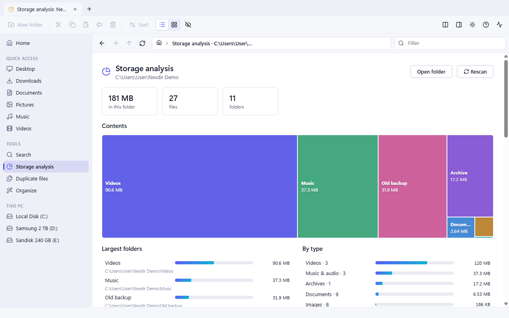
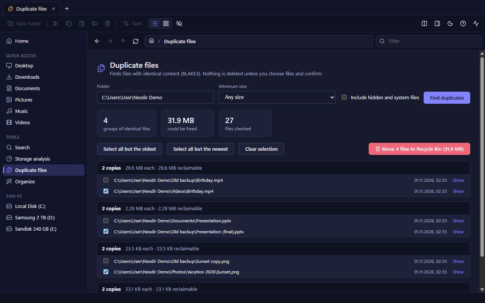
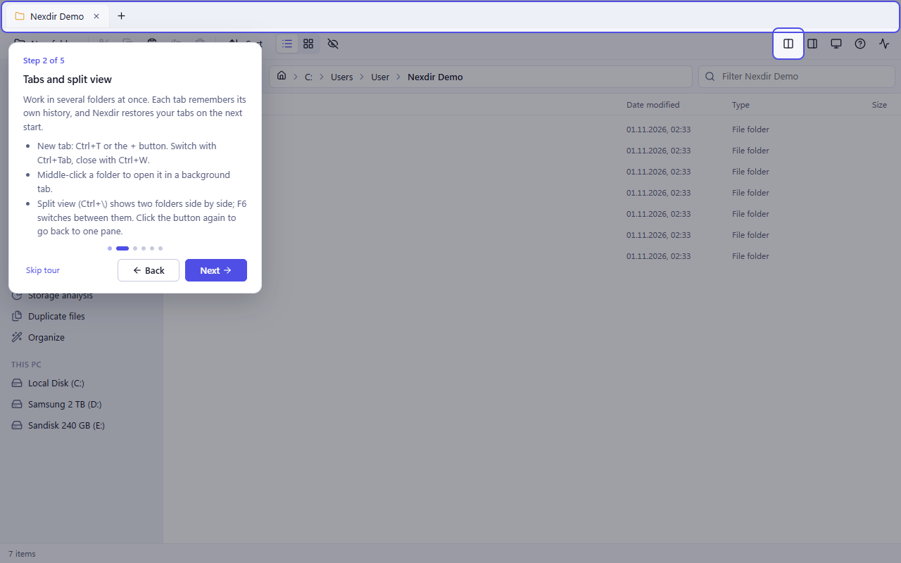
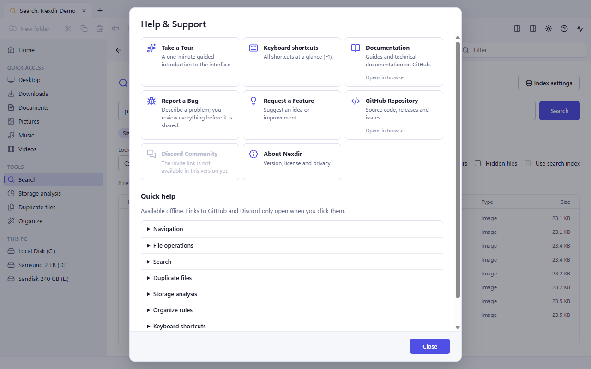

<p align="center">
  
</p>

<h1 align="center">Nexdir</h1>

<p align="center"><strong>A smarter way to manage your files.</strong><br>
A modern, intelligent, open-source file manager for Windows.</p>

<p align="center">
  <a href="https://github.com/Kervent/nexdir/releases">Download</a> ·
  <a href="#features">Features</a> ·
  <a href="#building-from-source">Build from source</a> ·
  <a href="CONTRIBUTING.md">Contribute</a> ·
  <a href="https://github.com/Kervent/nexdir/issues">Issues</a>
</p>

<p align="center">
  <a href="https://github.com/Kervent/nexdir/actions/workflows/ci.yml"></a>
</p>

---

> [!WARNING]
> **Nexdir is alpha software (version 0.4.3).** It is meant for early testers. It has been
> tested on Windows 11 only. **Keep backups of important files** and report anything unexpected.
> The release files are not code-signed yet.

<p align="center">
  
</p>

## Why Nexdir?

- **Safe by design.** Nexdir never deletes files permanently: removed items go to the Recycle
  Bin. It never replaces an existing file without asking. A replacement is written to a verified
  temporary copy first, so a cancelled or failed copy cannot destroy the original. Copying a
  folder never follows links or junctions.
- **Private.** No telemetry, no ads, no accounts, no cloud. Nexdir makes no network requests of
  its own; web pages (documentation, GitHub) open in your browser only when you click a link.
- **Fast.** A Rust backend does all file work off the UI thread, and lists are virtualised. A
  folder with 20,000 files opens in about 0.1 s.
- **Modern.** A Windows 11-style interface with light, dark and system themes and full keyboard
  support.
- **Independent.** Nexdir runs alongside Windows Explorer, needs no administrator rights and
  changes no system settings.

## Features

| Area | What you get |
|---|---|
| Navigation | Tabs (restored on the next start), split view, Home page, quick access, drives with usage, pinned folders, back/forward/up, breadcrumb and editable address bar (`%ENV%`, `~`), `nexdir.exe <folder>` |
| File list | Details and icon views, natural sorting with folders first, filter-as-you-type, hidden-file toggle, multi-select, type-ahead |
| Operations | New folder, rename (with undo), cut/copy/paste shared with the Windows clipboard, drag and drop, background queue with progress, speed, time left and cancellation, conflict choice (keep both / skip / replace), Recycle Bin, open with the default app, properties, copy path |
| Preview | Images, text files, folder item counts, file details |
| Search | Plain-English requests interpreted on your PC ("videos larger than 2 GB in Downloads"), wildcards, filters; optional local SQLite FTS5 index |
| Storage analysis | Treemap, largest folders and files, breakdown by type |
| Duplicate finder | Byte-identical files (BLAKE3); always keeps at least one verified copy (checked again in the backend before anything is removed); hard links are recognised |
| Organize | Rules that move or copy files, with a preview and confirmation before anything changes |
| Help | First-start tour of the interface, offline help, in-app bug reports and feature requests that open a prefilled GitHub form after you review them |

<table>
  <tr>
    <td></td>
    <td></td>
  </tr>
  <tr>
    <td align="center">Split view, dark theme</td>
    <td align="center">Search in plain English</td>
  </tr>
  <tr>
    <td></td>
    <td></td>
  </tr>
  <tr>
    <td align="center">Storage analysis</td>
    <td align="center">Duplicate finder</td>
  </tr>
  <tr>
    <td></td>
    <td></td>
  </tr>
  <tr>
    <td align="center">First-start tour</td>
    <td align="center">Help &amp; Support</td>
  </tr>
</table>

Screenshots show the real application with synthetic demo files.

## Download and installation

Get the latest version from the [Releases page](https://github.com/Kervent/nexdir/releases).
Each release contains:

| File | Use |
|---|---|
| `Nexdir-<version>-Setup.exe` | Installer for the current user. No administrator rights are needed. Recommended. |
| `Nexdir-<version>.msi` | MSI package. Installs for all users and needs administrator rights. |
| `Nexdir-<version>-Portable.zip` | Portable `Nexdir.exe`: unzip and run. |
| `SHA256SUMS.txt` | SHA-256 checksums of the files above |

**System requirements:** Windows 10 or 11 (64-bit) and the Microsoft Edge WebView2 Runtime.
WebView2 is part of Windows 11 and current Windows 10. The installer downloads it if it is
missing; the portable version expects it to be present. Nexdir has been tested on Windows 11
only so far.

**Unsigned builds.** The release files are not code-signed yet, so Windows SmartScreen may show
"Windows protected your PC". Check the file first, then choose *More info → Run anyway*:

```powershell
Get-FileHash .\Nexdir-0.4.3-Setup.exe -Algorithm SHA256
```

The result must match the line for that file in `SHA256SUMS.txt`. See
[docs/release/code-signing.md](docs/release/code-signing.md).

**Uninstalling.** Use *Settings → Apps*. Your settings are kept unless you tick *Delete the
application data* in the uninstaller. The portable version stores its data in
`%APPDATA%\org.nexdir.desktop` and `%LOCALAPPDATA%\org.nexdir.desktop`.

## Getting started

On the first start Nexdir offers a short tour; you can skip it and take it later with
**Help → Take a Tour** (the question-mark button in the toolbar). **Help & Support** has offline
help and all keyboard shortcuts. Press `F1` for the shortcut list:

| Keys | Action |
|---|---|
| `Ctrl+T` / `Ctrl+W` / `Ctrl+Tab` | New tab / close tab / next tab |
| `Ctrl+\` / `F6` | Split view / switch pane |
| `Ctrl+L` | Edit the address |
| `Ctrl+F` | Filter the current folder |
| `Ctrl+Shift+F` | Search |
| `Ctrl+C` / `Ctrl+X` / `Ctrl+V` | Copy / cut / paste |
| `F2` / `Ctrl+Z` | Rename / undo the last rename |
| `Del` | Move to the Recycle Bin |
| `Alt+P` | Preview pane |

## Reporting bugs and requesting features

Use **Help → Report a Bug** or **Help → Request a Feature** in Nexdir. You see exactly what will be
shared: file paths, your user name, e-mail addresses and anything that looks like a password or
token are replaced with placeholders. Then Nexdir opens the prefilled GitHub form in your browser;
nothing is sent until you submit it there. You can also open an
[issue](https://github.com/Kervent/nexdir/issues/new/choose) directly.

**Security vulnerabilities** must be reported privately, see [SECURITY.md](SECURITY.md).

## Technology

| Part | Technology |
|---|---|
| Application shell | [Tauri 2](https://tauri.app) with the Microsoft Edge WebView2 Runtime |
| Backend | Rust: file operations, search, analysis; Win32 APIs through the `windows` crate |
| User interface | React 19 and TypeScript, built with Vite; icons from Lucide |
| Search index | SQLite with FTS5 (bundled through `rusqlite`) |
| Hashing | BLAKE3 |
| Tests | Vitest and Testing Library (frontend), `cargo test` (backend) |
| Tools | Python scripts for the Discord community setup and release announcements (not part of the app) |

Architecture: [docs/architecture/overview.md](docs/architecture/overview.md).

## Building from source

Requirements: Windows 10/11 x64, Node.js 22+, Rust (stable, MSVC toolchain), and Visual Studio
Build Tools with the "Desktop development with C++" workload.

```bash
npm ci
npm run app:dev                                   # run in development mode
npm test                                          # frontend tests
cargo test --manifest-path src-tauri/Cargo.toml   # backend tests
npm run app:build                                 # release build and installers
powershell -ExecutionPolicy Bypass -File tools/release/package.ps1 -Clean   # release files + SHA256SUMS.txt
```

Full instructions: [docs/development/setup.md](docs/development/setup.md). All documentation:
[docs/](docs/README.md).

## Contributing

Contributions are welcome: code, testing, documentation, translations, support.

- [CONTRIBUTING.md](CONTRIBUTING.md) and [your first contribution](docs/development/first-contribution.md)
- [Community guidelines](docs/community/guidelines.md) and the [Code of Conduct](CODE_OF_CONDUCT.md)
- [Roadmap](docs/ROADMAP.md) and [changelog](CHANGELOG.md)

## Community

Questions and ideas are welcome in [GitHub Issues](https://github.com/Kervent/nexdir/issues).
A Nexdir Community server on Discord is being prepared. Its invite link will be added here and in
the app's Help & Support once it is public.

## License

Nexdir is released under the [MIT License](LICENSE) © Nexdir contributors.
The release files contain third-party components under their own licenses (MIT, Apache-2.0,
BSD, ISC, Zlib, Unicode, MPL-2.0 and others), listed with their full license texts in
[THIRD-PARTY-NOTICES.txt](THIRD-PARTY-NOTICES.txt).
